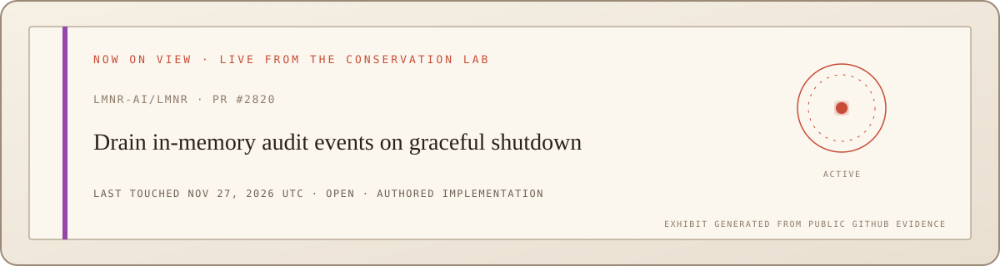

# Divanshu Sharma

Applied AI / ML Systems Engineer · Founding Engineer at Uniiq.ai

I build systems around language models. I like the part of engineering where a question gets small enough to settle with five log entries and a test.

[Portfolio](https://div90.vercel.app/) · [Résumé](./Divanshu_Resume.pdf) · [Open-source contributions](./OPEN_SOURCE.md)

## The missing three

You're reviewing a logger. Five entries are waiting when the application shuts down. The transport sends two entries per batch. Every write to storage succeeds.

```text
queued       A  B  C  D  E
persisted    A  B
shutdown     complete
```

**You get one more test. What do you assert before shutdown can report success?**

<details>
<summary>Open my test case</summary>

I’d check storage for all five entries when the shutdown callback fires. A test with just two entries passes even with the bug. The fifth entry matters because it forces a partial final batch.

In Mastra’s Upstash transport, shutdown flushed once. My fix drains successive batches and passes a write error to the callback if draining fails. The regression test sends five entries in batches of two, two, and one. [Read the merged diff and test](https://github.com/mastra-ai/mastra/pull/26174/files)

</details>

<details>
<summary>Try the same question against a model catalog</summary>

A provider returns a page of models. The request succeeded. Can the client tell its caller it has the whole catalog?

Only after it checks whether the provider has another page. The logging bug lost the tail of a queue. This one lost the tail of a catalog. Both produced perfectly ordinary-looking output. [Read my pagination fix](https://github.com/experientiallabs/experiential/pull/1056/files)

</details>

## Pick a question to follow

| If you’re wondering… | Open this exhibit |
| --- | --- |
| Two checkpoints answer differently. Where did their behavior diverge? | [Neural Bisect](https://github.com/sdivyanshu90/neural-bisect) · Trace a regression through the model. |
| The score went up. What exactly did the benchmark measure? | [EvalForge](https://github.com/sdivyanshu90/EvalForge) · Inspect the evaluation and its scorers. |
| The weights fit in four bits. How much accuracy did that cost? | [FromScratchQuant](https://github.com/sdivyanshu90/FromScratchQuant) · Measure the loss from compression. |
| A provider goes offline halfway through serving traffic. Where does the next request go? | [AI Gateway](https://github.com/sdivyanshu90/build-your-own-ai-gateway) · Follow routing and failover. |
| One layer spans several GPUs. Which device owns each piece? | [Distributed training](https://github.com/sdivyanshu90/build-your-own-distributed-training/blob/HEAD/docs/ARCHITECTURE.md) · Walk through a training loop built on PyTorch primitives. |
| A model wrote some Python. What should that process be allowed to touch? | [Code interpreter](https://github.com/sdivyanshu90/build-your-own-code-interpreter) · Inspect the execution boundary. |

## At the repair bench

I keep a public record of the symptom, the fix I submitted, and what happened upstream. One case starts with a missing directory. Another starts with logs that disappear during shutdown. [Open the conservation notebook](./OPEN_SOURCE.md#restoration-records)

<a href="https://github.com/pulls?q=is%3Apr+author%3Asdivyanshu90+is%3Aopen">
  <picture>
    <source media="(prefers-color-scheme: dark)" srcset="./assets/now-on-view-dark.svg">
    <source media="(prefers-color-scheme: light)" srcset="./assets/now-on-view-light.svg">
    
  </picture>
</a>
